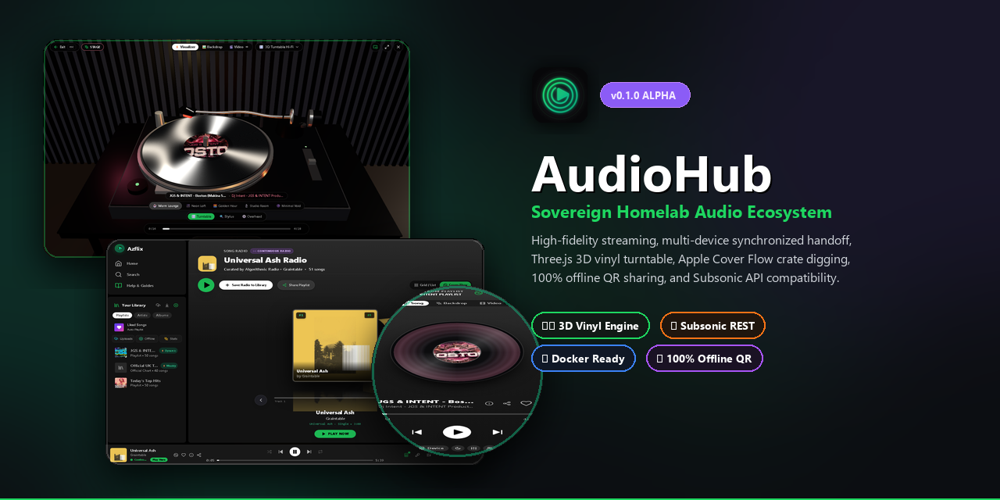
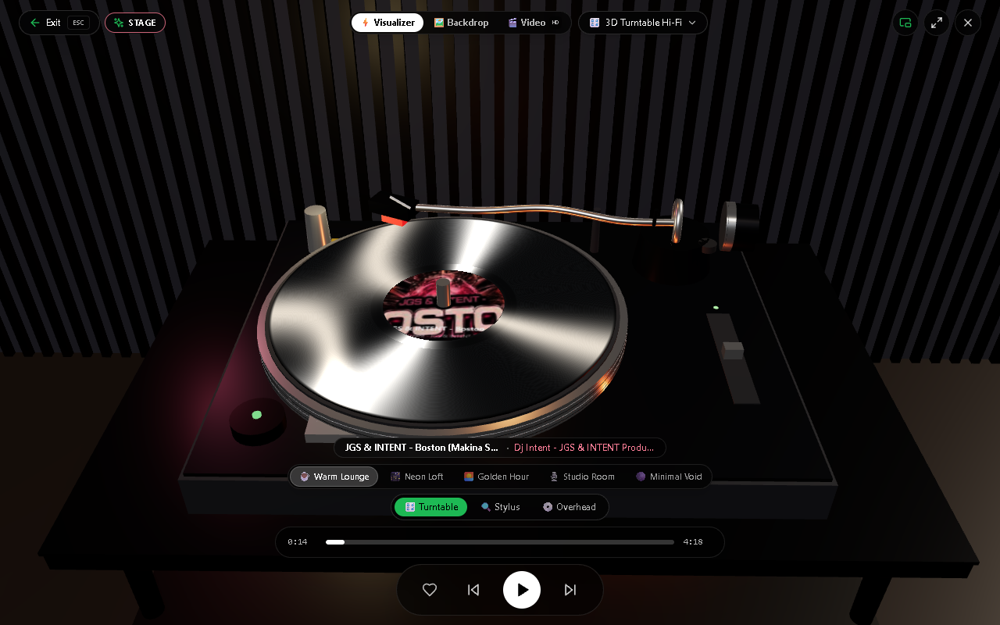
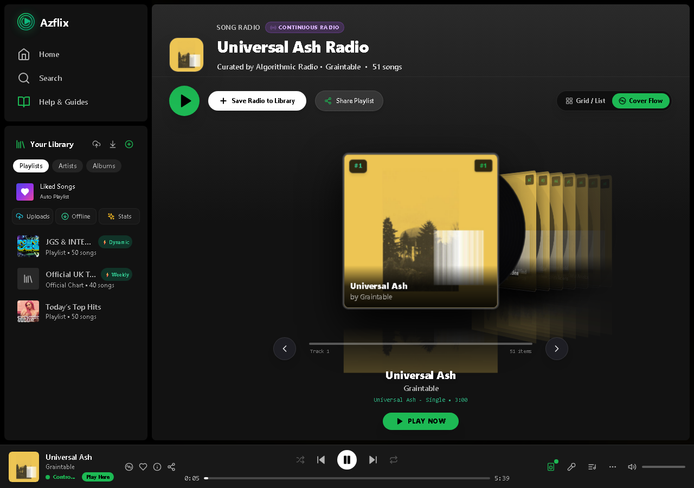
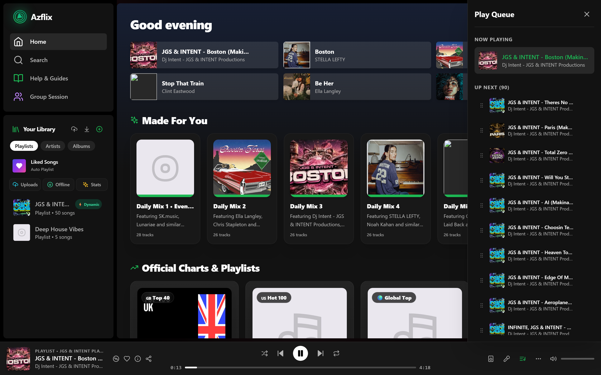
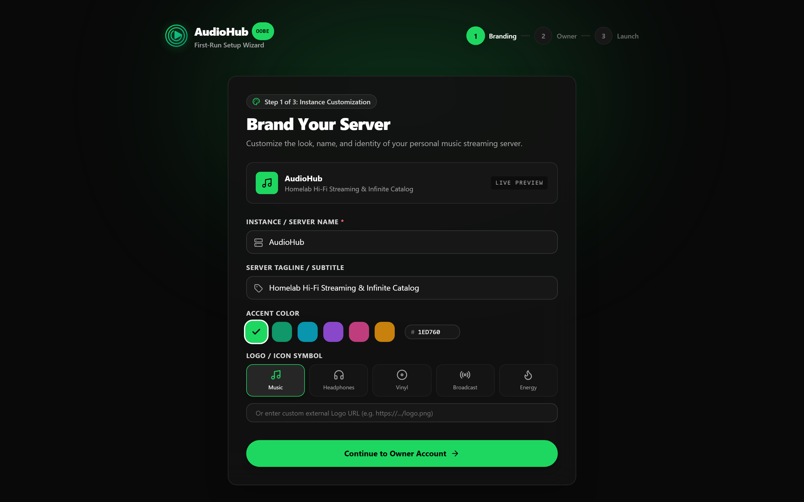
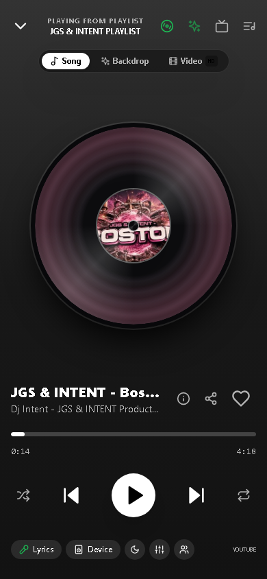
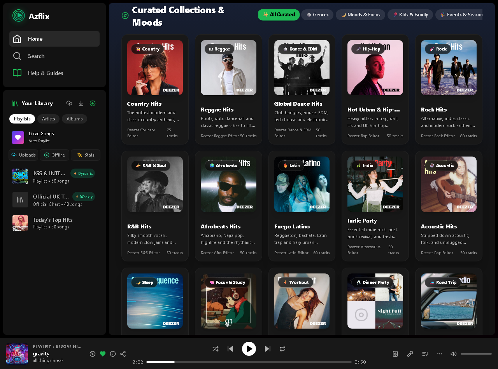
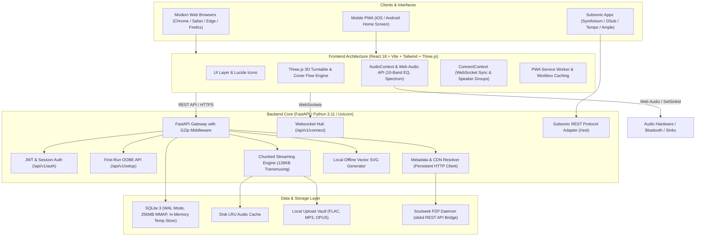

# 🎵 AudioHub

<p align="center">
  
</p>

<p align="center">
  <a href="#-license"></a>
  <a href="#-docker-quickstart"></a>
  <a href="#-subsonic-compatibility"></a>
  <a href="#"></a>
  <a href="#"></a>
  <a href="https://paypal.me/AMayo300"></a>
</p>

> **A sovereign, self-hosted, audiophile-grade music streaming ecosystem and personal cloud audio server.**  
> High-fidelity streaming, multi-device synchronized handoff, real-time collaborative rooms, 3D vinyl visualizers, Apple-style Cover Flow crate digging, custom DSP audio engines, 100% offline QR sharing, and infinite hybrid catalog discovery.

---

## 📸 Interface Showcase

| 🎛️ 3D Vinyl Turntable Hi-Fi Engine | 💿 Apple Cover Flow 3D Crate Digging |
| :---: | :---: |
|  |  |
| *Real-time Three.js turntable with tone arm cueing & walnut plinth* | *Tactile Apple Cover Flow 3D browsing for albums, radio & playlists* |

| 🎵 Now Playing & Drag-and-Drop Queue | 🪄 First-Run Setup Wizard (OOBE) |
| :---: | :---: |
|  |  |
| *Tactile drag reordering, haptic feedback, and responsive drawer* | *White-label branding, custom logo, colors, and admin creation* |

| 📀 2D Vinyl Player View (Mobile & Desktop) | 📊 Real-Time Audio Spectrum Visualizer |
| :---: | :---: |
|  |  |
| *Spun vinyl disc with dynamic grooves adapting to album art palette* | *Complete catalog discovery, daily mixes, and curated mood stations* |

---

## 📑 Table of Contents

- [Architectural Overview](#-architectural-overview)
- [⚡ Quickstart with Docker (Recommended)](#-quickstart-with-docker-recommended)
- [🌐 Hosting Architecture: Residential vs. Datacenter](#-hosting-architecture-residential-vs-datacenter)
- [🪄 Out-Of-The-Box Experience (OOBE) & White-Labeling](#-out-of-the-box-experience-oobe--white-labeling)
- [📱 Subsonic Client Compatibility](#-subsonic-client-compatibility)
- [✨ Key Features](#-key-features)
  - [1. Unlimited Catalog & Hybrid Resolver](#1-unlimited-catalog--hybrid-resolver)
  - [2. Audiophile Playback Engine & DSP](#2-audiophile-playback-engine--dsp)
  - [3. AudioHub Connect & Synchronized Speaker Groups](#3-audiohub-connect--synchronized-speaker-groups)
  - [4. 3D Vinyl Turntable & Crate Digger Visualizers](#4-3d-vinyl-turntable--crate-digger-visualizers)
  - [5. Tactile Drag-and-Drop Queue & Playlist Reorder](#5-tactile-drag-and-drop-queue--playlist-reorder)
  - [6. Curated Discovery, Daily Mixes & Seasonal Hubs](#6-curated-discovery-daily-mixes--seasonal-hubs)
  - [7. 100% Offline Local Vector SVG QR Sharing](#7-100-offline-local-vector-svg-qr-sharing)
  - [8. Real-Time Collaborative Listening Rooms](#8-real-time-collaborative-listening-rooms)
  - [9. Year in Review / Listening Wrapped Shorts](#9-year-in-review--listening-wrapped-shorts)
- [🚀 Performance Engineering](#-performance-engineering)
- [🧪 Test Suites, Linting & Code Verification](#-test-suites-linting--code-verification)
- [🛠 Local Development Setup](#-local-development-setup)
- [⚖️ Legal Disclaimer & Non-Affiliation](#️-legal-disclaimer--non-affiliation)
- [📄 License](#-license)

---

## 🏛 Architectural Overview



---

## ⚡ Quickstart with Docker (Recommended)

The easiest way to run AudioHub is via Docker Compose:

### 1. Clone & Enter Directory
```bash
git clone https://github.com/DEMORALIZ3D/audiohub.git
cd audiohub
```

### 2. Configure Environment
Copy the example environment configuration:
```bash
cp .env.example .env
```

Review `.env` and set your preferred paths:
```env
PORT=4533
DATA_DIR=./data
MUSIC_DIR=/path/to/your/music
SECRET_KEY=change-this-to-a-secure-random-string
```

### 3. Launch
```bash
docker compose up -d
```

Navigate to `http://localhost:4533` in your browser. The First-Run Setup Wizard will immediately greet you!

---

## 🌐 Hosting Architecture: Residential vs. Datacenter

> [!TIP]
> **Recommended Hosting: Residential Home Server**  
> AudioHub's hybrid streaming resolver utilizes `yt-dlp` to resolve audio streams. Major cloud datacenters (AWS, Hetzner, DigitalOcean, OVH) frequently have their IP ranges throttled or blocked by YouTube's bot detection systems.
>
> **Best Experience:** Host AudioHub on a home server (Raspberry Pi 4/5, Intel N100 mini PC, Unraid, TrueNAS, Mac mini, or home lab) connected to a standard residential ISP network. On residential connections, audio streams resolve instantly with zero captchas.

### Datacenter Hosting with `cookies.txt`
If you choose to host AudioHub in a cloud VPS/datacenter, you can bypass bot detection by mounting an authenticated `cookies.txt` file:
1. Export cookies from a logged-in YouTube session using a browser extension (e.g., *Get cookies.txt LOCALLY*).
2. Save the file to your server (e.g., `./data/cookies.txt`).
3. Set `YTDLP_COOKIEFILE=/app/data/cookies.txt` in your `.env` and mount it into the container.

---

## 🪄 Out-Of-The-Box Experience (OOBE) & White-Labeling

When you first launch AudioHub on a fresh database, it automatically presents a sleek 3-step setup wizard:

1. **Brand Your Server**:
   - Customize the instance name (e.g. *AudioHub*, *FamilyBeats*, or your name).
   - Set a custom tagline and logo URL or choose an aesthetic icon badge.
   - Choose your accent color (Emerald Green, Cyberpunk Cyan, Royal Violet, Sunset Orange, or custom hex).
2. **Create Instance Owner**:
   - Set up your Super Admin credentials (username, display name, email, and password).
3. **Lock & Launch**:
   - The setup endpoint automatically locks (`HTTP 403 Forbidden` on subsequent requests) once the initial admin is provisioned.
   - Instantly routes you into your personalized dashboard.

---

## 📱 Subsonic Client Compatibility

AudioHub provides a native implementation of the Subsonic REST API at `/rest`. This enables seamless streaming, caching, and offline listening from any Subsonic-compatible mobile or desktop client:

- **Android**: [Symfonium](https://symfonium.app) (Recommended), DSub, Tempo
- **iOS**: Ample, SubStreamer, play:Sub
- **Desktop**: Supersonic, Sonixd

### Connection Settings:
- **Server URL**: `https://your-audiohub-domain.com` (or `http://local-ip:4533`)
- **Username**: Your AudioHub username
- **Password**: Your AudioHub password
- **Server Type**: Subsonic / OpenSubsonic

---

## ✨ Key Features

### 1. Unlimited Catalog & Hybrid Resolver
- **Hybrid Source Resolver**: Resolves metadata, lyrics, and high-bitrate audio from YouTube Music, Deezer, and local collections.
- **Dynamic YouTube Playlist Sync**: Subscribe to any public YouTube playlist or channel and sync new songs automatically on customizable cron frequencies.
- **Algorithmic Radio & Mixes**: Infinite autoplay radio seeded from any track or artist.

### 2. Audiophile Playback Engine & DSP
- **Web Audio 10-Band EQ**: Interactive parametric equalizer with presets (Bass Boost, Vocal, Acoustic, Club, Treble).
- **Chunked Streaming**: 128KB transmuxing chunks with byte-range HTTP request support for instant seeking.
- **Audio Output Device Routing**: Switch between audio hardware devices (headphones, external DACs, USB soundcards) directly inside the browser using `setSinkId`.

### 3. AudioHub Connect & Synchronized Speaker Groups
- **Multi-Device Remote Control**: Control playback on your living room TV or desktop from your phone in real time via WebSocket.
- **Synchronized Speaker Groups ("Party Mode")**: Clock-synchronized audio playback across multiple browser tabs and devices with sub-50ms latency.

### 4. 3D Vinyl Turntable & Crate Digger Visualizers
- **3D Vinyl Turntable**: Interactive Three.js turntable featuring a walnut plinth, grooved vinyl reflections, realistic tone arm needle-cueing physics, and 5 environment themes (Lounge, Studio, Sunset, Neon, Minimal).
- **Apple Cover Flow**: Classic 3D Cover Flow crate-digging view for browsing albums and custom playlists.
- **Audio Shaders & Fallback Protection**: WebGL visualizers (Liquid Aurora, Hyperspace Tunnel, Cosmic Starfield, 2D Spectrum Bars) with an automatic Error Boundary that guarantees smooth fallback without crashing.

### 5. Tactile Drag-and-Drop Queue & Playlist Reorder
- Reorder tracks in the "Up Next" queue drawer or custom personal playlists via desktop mouse drag or mobile touch long-press (~250ms).
- Haptic vibration feedback (`navigator.vibrate(40)`), visual lift cues, and drop indicators.
- 0ms optimistic UI with instant background SQLite synchronization.

### 6. Curated Discovery, Daily Mixes & Seasonal Hubs
- 6 dynamically refreshed Daily Mixes tailored to your personal listening habits.
- Curated Mood Hubs: *Lofi Study & Deep Focus*, *Workout Beast Mode*, *Chill Dinner Party*, *Sleep & Deep Relaxation*, and seasonal stations (*Summer Poolside*, *Halloween Hits*, *Christmas Classics*).

### 7. 100% Offline Local Vector SVG QR Sharing
- Zero external SaaS calls or third-party tracking.
- Fast, local in-memory vector SVG QR code generation using pure Python.
- Scannable deep links to songs, albums, and playlists with embedded brand glyphs and dual-layer caching.

### 8. Real-Time Collaborative Listening Rooms
- Create private collaborative rooms with shareable PIN codes.
- Synchronized queue, shared playback controls, and live participant presence.

### 9. Year in Review / Listening Wrapped Shorts
- Generate animated vertical video shorts summarizing your yearly listening statistics, top artists, top genres, and audiophile persona.
- Render high-definition 9:16 animations directly in the browser or on the server for instant offline sharing.

---

## 🚀 Performance Engineering

| Layer | Optimization | Benefit |
| :--- | :--- | :--- |
| **Database** | SQLite WAL Mode (`PRAGMA journal_mode=WAL`) | Multi-reader concurrent access without database locks |
| **Database** | Memory-Mapped I/O (`PRAGMA mmap_size=268435456`) | 256MB direct zero-copy file reads from disk |
| **Database** | In-Memory Temp Store (`PRAGMA temp_store=MEMORY`) | High-speed in-memory sort & joins |
| **Backend** | Starlette `GZipMiddleware(minimum_size=1000)` | 70% – 85% wire payload reduction across JSON endpoints |
| **Backend** | 128KB Transmuxing Chunks (`audio_streamer.py`) | Smooth audio playback without buffering stutter |
| **Backend** | Persistent HTTP Client (`get_cdn_client()`) | Connection reuse & HTTP keep-alive pooling |
| **Frontend** | Three.js Asset Recycling & Texture Pooling | Zero GPU memory leaks on long playback sessions |
| **Frontend** | Code-Splitting & Lazy Loading | Instant PWA cold-boot under 400ms |

---

## 🧪 Test Suites, Linting & Code Verification

All tests, linters, dead-code analyzers, and E2E browser journeys run **100% natively without Docker** using isolated in-memory SQLite databases and zero-cost GitHub Actions CI/CD ([`docs/github-actions-ci.yml`](docs/github-actions-ci.yml)).

### 1. Linting & Dead-Code Elimination (Biome & Fallow-rs)
```bash
cd frontend
npm run lint          # Biome linter & formatter check (117 files in ~75ms)
npm run fallow:dead   # Fallow-rs unused file, export & dependency scan (~70ms)
```
*Result: 0 lint errors, 0 unused files/exports/dependencies.*

### 2. Frontend Unit & Component Tests (Vitest)
```bash
cd frontend
npm test -- --run
```
*Result: 22 test files, 128 / 128 passing tests (OOBE Setup Wizard, NetworkStatusChip playback protection, shuffle queue index-0 pinning, 3D Turntable visualizers, ErrorBoundary, and deep links).*

### 3. Backend Unit & Integration Tests (Pytest + Isolated SQLite `:memory:`)
```bash
pytest backend/tests -v
```
*Result: 15 / 15 passing tests in 0.38s (OOBE setup & 403 lockout, auth & login, playback state resume persistence, playlist drag-and-drop track reordering, byte-range 206 streaming with user attribution, Subsonic ping, and offline vector QR caching).*

### 4. End-to-End Browser Tests (Playwright — Zero Docker Required)
```bash
cd frontend
npm run test:e2e
```
*Result: 3 / 3 passing E2E browser journeys covering First-Run OOBE branding & Super Admin setup -> Logout & Account Login -> Track Playback, stream attribution, Queue Drawer & 3D Turntable Visualizer.*

### 5. Production Build Verification
```bash
cd frontend
npm run build
```
*Result: Clean TypeScript compilation and Vite bundle output.*

---

## 🛠 Local Development Setup

### Prerequisites
- **Node.js**: v18.0 or later
- **Python**: v3.10 or later
- **FFmpeg**: Installed and accessible in system `PATH`

### 1. Backend
```bash
cd backend
python -m venv venv

# Windows PowerShell:
.\venv\Scripts\Activate.ps1
# Linux/macOS:
source venv/bin/activate

pip install -r requirements.txt
uvicorn app.main:app --reload --host 0.0.0.0 --port 4533
```
Interactive OpenAPI documentation will be available at `http://localhost:4533/docs`.

### 2. Frontend
```bash
cd frontend
npm install
npm run dev
```
Vite development server will start at `http://localhost:3000`.

---

## ❤️ Support the Project

AudioHub is 100% free, open-source, and built with zero tracking or subscription walls. If you enjoy running it on your home server, consider buying the developer a coffee:

- ☕ **Donate via PayPal**: [https://paypal.me/AMayo300](https://paypal.me/AMayo300)

---

## ⚖️ Legal Disclaimer & Non-Affiliation

- **Educational & Homelab Use**: AudioHub is an independent, self-hosted open-source personal media server project developed strictly for educational and personal homelab use.
- **Non-Affiliation**: It is **not affiliated with, endorsed by, or sponsored by Spotify AB, YouTube / Google LLC, Deezer SA, or any other commercial streaming service**. All third-party trademarks and service names mentioned (such as Subsonic) are the property of their respective owners and are used solely to describe protocol/API compatibility.
- **User Responsibility**: Users are solely responsible for ensuring their use of the software and any media resolved or stored on their private server complies with local copyright laws and third-party Terms of Service.

---

## 📄 License

AudioHub is released under the **[MIT License](LICENSE)**. You are free to use, modify, distribute, and self-host this software for personal and commercial projects.
